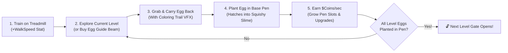

# Find a Squishy! (Egg Hunt, Treadmill & Pen Tycoon) — Design Specification

**Date:** 2026-10-17
**Project:** `Find a Squishy!` (Roblox / Luau / Rojo 7.7.1)
**Target Audience:** Family Co-op & Competitive Play (Parent + Kids) & Public Roblox Top-30 Loop

---

## 1. Executive Summary & Core Vision

**Find a Squishy!** fuses the discovery excitement of *Find the Markers/Chomiks* with the physical loop of *Steal an Egg*:
1. **Find Hidden Squishy Eggs in Each Level:** Each of the 5 themed levels has hidden, disguised, or guarded **Squishy Eggs**.
2. **Carry & Plant in Your Base Pen to Unlock the Next Level:** Finding an egg isn't enough—players pick up the Egg and **physically carry it back to their Base Pen** to **plant it in an Egg Nest**. A player **cannot unlock the next Level Gate until 100% of the Eggs from their current level are planted in their Pen!**
3. **Treadmill Speed Training:** Every player has a **Speed Treadmill** at their base (and in the Hub). Running on the treadmill increases the player's **Speed Stat** (`WalkSpeed`), which is critical for hauling heavy/rare Eggs back faster, jumping across parkour gaps, and chasing down runaway eggs or family members.
4. **Make Money to Grow Your Pen:** Once planted in the Pen, each Egg hatches into a bouncing, cute **Squishy Slime** that continuously generates **$Coins/sec**. Players spend their Coins to **Expand Their Pen** (unlocking additional Nest Slots required to plant higher-level eggs), upgrade their **Treadmill Tier** (`2x / 5x / 10x Speed Gain`), coat their Pen in **Golden/Rainbow Gel**, and buy **Base Shields / Slime Slap Tools**.
5. **High-Converting Monetization Systems:**
   - **Paid Egg Guide Beam ("Direct Me to Egg"):** Players can buy/activate an **Egg Guide Beam** (for a specific Egg in the Slimeopedia or the nearest unplanted Egg in their level) that draws a glowing 3D animated ribbon beam & floating fairy orb directly from their character to the hidden Egg that hatches that Squishy!
   - **Coloring Trails & Footsteps Shop:** Players can unlock and equip vibrant **Coloring Trails** (Neon Cyan, Cotton Candy Pink, Golden Sparkle, Lava Fire, and VIP Rainbow Paint Trail) that leave a glowing ribbon and colored paint/splat trail behind them as they run on the treadmill and hunt for eggs.
   - **Robux Gamepasses & DevProducts (`MarketplaceService`):** Wired with real `MarketplaceService` prompts AND an automatic **Family / Studio Free-or-Coins Fallback** so you and your kids can test and enjoy every paid perk immediately, while public players can purchase with Robux once you plug in your Gamepass/Product IDs on `create.roblox.com`.

---

## 2. The Core Gameplay Loop



### Key Mechanics & Signature Twists

#### 1. Physical "Find & Plant" Egg Progression
- **Hidden Eggs (`35 Total` across 5 Levels):** Eggs are tucked into clever hiding spots (behind waterfalls, inside hollow trees, atop gumball machines, inside micro-vents, or inside Co-op Buddy Vaults).
- **Living Egg Behaviors:**
  - `Static`: Classic hidden spot.
  - `Disguised`: Disguised as a bush, marshmallow, toy block, hologram cube, or lava rock until you get close, then it wiggles and reveals its colorful shell!
  - `Runaway`: Sprouts little legs/bounces away when approached—requires **Treadmill Speed** to catch!
  - `BounceWake`: Giant sleepy egg blocking a path—bounce on top of it 3 times to wake and grab it.
- **Carrying & Planting:**
  - Touching an unplanted Egg attaches it to your hands/head (`CarryingEggId`).
  - You must have an **open Nest Slot** in your Base Pen (bought by growing your Pen with Coins) and step onto your **Base Planting Zone** to plant the Egg!
  - Once planted, the Egg cracks open in a celebratory burst and spawns that unique **Squishy Slime** permanently in your Pen.

#### 2. Treadmill Speed Training System
- **Physical Treadmills in Every Base:** Stepping onto the glowing moving belt of your Base Treadmill automatically triggers a running animation/particles and grants **+Speed XP every 0.4 seconds**, permanently increasing your `WalkSpeed`.
- **Treadmill Upgrades (Bought with Coins):**
  - *Tier 1 (Starter Belt):* `+0.5 Speed` per tick
  - *Tier 2 (Turbo Neon Treadmill):* `+1.5 Speed` per tick
  - *Tier 3 (Supersonic Cyber Treadmill):* `+4.0 Speed` per tick + Flame Trail
  - *Tier 4 (Anti-Gravity Magma Treadmill):* `+10.0 Speed` per tick + Super Jump Boost

#### 3. Growing Your Pen (Base Expansion Economy)
- Your Base Pen starts at **Pen Level 1 (5 Nest Slots)**—just enough to plant all 5 Eggs from **Level 1: Meadow Gardens**.
- To plant Eggs from **Level 2 (6 Eggs)**, **Level 3 (7 Eggs)**, **Level 4 (8 Eggs)**, and **Level 5 (9 Eggs)**, you must spend the **$Coins** generated by your hatched Squishies on the **[Expand Pen (+Nest Slots)]** button at your base!
- Expanding your Pen physically widens the glowing neon fence and adds a new row of **Golden Egg Nests** to your plot.

#### 4. Monetization Add-ons: Paid Egg Guide & Coloring Trails
- **Paid Egg Guide ("Guide Me to This Squishy's Egg"):**
  - In the **Slimeopedia Index** (and on a quick HUD **`[🧭 Buy Egg Guide]`** button), any unplanted Squishy shows a **`[🧭 Guide Me to Egg]`** button.
  - Purchasing/activating the guide (via Coins or Robux Developer Product / VIP Guide Pass) spawns a **Golden Guide Beam & Floating Helper Orb** attached from the player's torso directly to that exact hidden Egg in the world, showing live distance in studs (`"🧭 Guiding to: Berry Blush Egg (64 studs)"`) until the player picks it up!
- **Coloring Trails Shop (`Trails & Paint` Tab):**
  - Players can buy and equip **6 Coloring Trails** (with Coins or VIP Robux Pass):
    1. `Slime Green Splash` (Leaves green slime droplets + ribbon trail)
    2. `Electric Cyan Laser` (Bright neon cyan speed ribbon + floor paint splats)
    3. `Cotton Candy Sparkle` (Pastel pink & blue dual ribbon + sparkles)
    4. `Solar Gold VIP` (24k Gold ribbon + +10% Coin bonus while equipped)
    5. `Magma Flame Trail` (Fiery orange/red trail + +4 Bonus WalkSpeed)
    6. `Rainbow Prism Master Trail` (Full HSV animated rainbow ribbon + colors the ground with fading rainbow paint pads under your feet as you walk!)
- **Interactive Squishies, Morphing & Family Steal/Defense:**
  - **Click-to-Squish Fidget Bonus:** Click any hatched Squishy in your Pen to pancake-squish it for squeaky sound effects and instant bonus coin showers!
  - **Squishy Morphing & Micro-Vents:** Morph into any Squishy you've hatched, and toggle **Micro-Squishy Size (`0.4x`)** to squeeze through small mouse-hole vents that hide secret Eggs.
  - **Family Raid / Steal-an-Egg & Base Shield:** Players can use the **Slime Slap Glove** to boop someone carrying an unplanted Egg (stealing the carried Egg!) or raid an unshielded Pen unless the owner activates their **Base Laser Shield**.

---

## 3. World Layout & 5 Level Biomes (35 Eggs to Find & Plant)

All geometry is generated procedurally on server startup via `WorldBuilder.luau` along the `-Z` axis starting from the Central Hub (`0, 0, 0`).

| Zone | Z-Range | Theme & Visual Palette | Gate Requirement | Eggs in Zone | Required Pen Size |
| :--- | :--- | :--- | :--- | :--- | :--- |
| **Hub Plaza & 6 Base Pens** | `+120` to `-40` | Central plaza, 6 Claimable Tycoon Pens (3 Left, 3 Right) with Treadmills, Cash Collectors, Expand Pen Pads & Nests | `0` (Spawn) | `0` (Sanctuary) | Starts at **Pen Tier 1 (5 Nests)** |
| **Level 1: Meadow Gardens** | `-40` to `-220` | Lush green hills, oak trees, wooden bridge over creek, picnic table, hollow bushes | `0` (Open) | **5 Eggs** (`#1–#5`) | **Pen Tier 1** (5 Nests total) |
| **Level 2: Candy Kingdom** | `-220` to `-400` | Pastel pink turf, giant lollipops, gumball obby towers, frosting waterfall, marshmallow pits | **All 5 Level 1 Eggs Planted** | **6 Eggs** (`#6–#11`) | **Pen Tier 2** (11 Nests total) |
| **Level 3: Toybox Bedroom** | `-400` to `-580` | Warm wood floor, giant ABC blocks, bouncy bed mattress trampoline, bookshelf climb, toy chest | **All 11 L1–L2 Eggs Planted** | **7 Eggs** (`#12–#18`) | **Pen Tier 3** (18 Nests total) |
| **Level 4: Neon Cyber Lab** | `-580` to `-760` | Dark slate & cyan/magenta neon grid, containment tubes, floating laser platforms, server racks | **All 18 L1–L3 Eggs Planted** | **8 Eggs** (`#19–#26`) | **Pen Tier 4** (26 Nests total) |
| **Level 5: Magma & Crystal Caverns** | `-760` to `-960` | Basalt rock, glowing lava rivers, amethyst crystals, volcano peak | **All 26 L1–L4 Eggs Planted** | **9 Eggs** (`#27–#35`) | **Pen Tier 5** (35 Nests total) |

---

## 4. Technical Architecture & File Structure

Built with **Rojo 7.7.1** (`default.project.json`) so `rojo build -o FindASquishy.rbxl` produces a complete, standalone Roblox place file ready to open in Roblox Studio and publish to `create.roblox.com`.

```text
clever-maxwell/
├── default.project.json          # Rojo project mapping
├── rokit.toml                    # Toolchain manifest (rojo 7.7.1)
├── FindASquishy.rbxl             # Compiled ready-to-play Roblox Studio file
└── src/
    ├── shared/                   # ReplicatedStorage.Shared
    │   ├── SlimeData.luau        # All 35 Eggs/Slimes: ID, Name, Level, Rarity, Color, Behavior, Income, Hint, Position
    │   ├── UpgradeData.luau      # Pen Expansion Tiers, Treadmill Tiers, Coloring Trails, Guide Pass, Monetization IDs
    │   └── SquishyBuilder.luau   # Procedural 3D Egg & Hatched Squishy Slime builder (spotted shells, eyes, blush, hats)
    ├── server/                   # ServerScriptService.Server
    │   ├── WorldBuilder.luau     # Builds Hub, 6 Expandable Base Pens + Treadmills + Nests, 5 Biomes, Gates & Eggs
    │   └── GameServer.server.luau# DataStore/Session state, Egg Pickup -> Carry -> Plant loop, Trails, Guide, Marketplace
    └── client/                   # StarterPlayer.StarterPlayerScripts.Client
        └── GameClient.client.luau# HUD (Carried Egg Banner, Egg Guide 3D Beam, Trails Shop, Slimeopedia, Gates)
```
